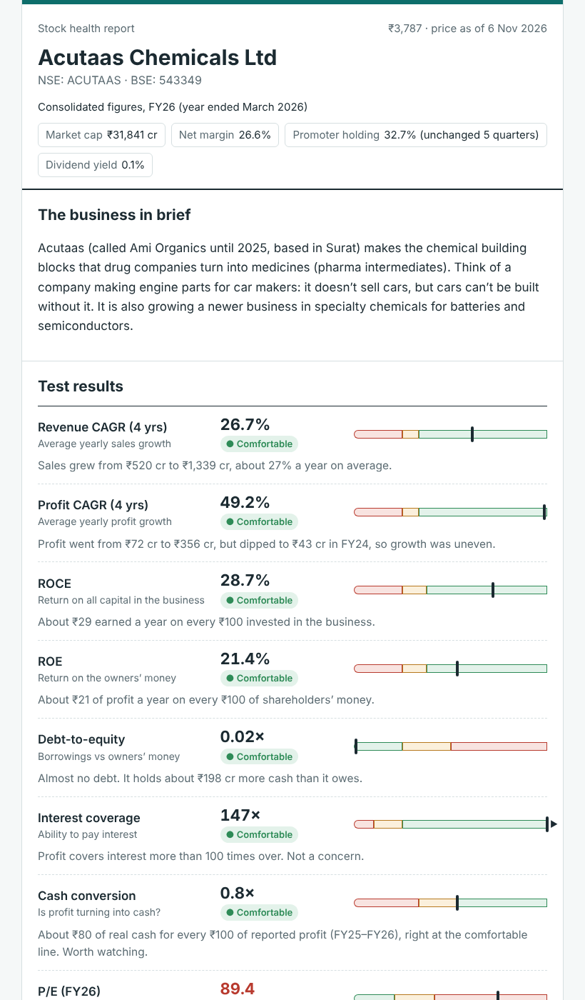
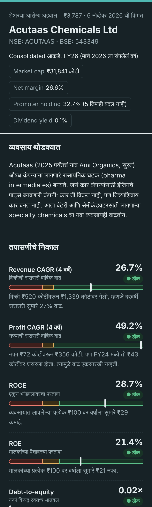

# India Stock Mentor

A [Claude skill](https://docs.claude.com/en/docs/agents-and-tools/agent-skills/overview) that teaches beginners how Indian stocks work, **in their own language**. Ask about any NSE/BSE company and it explains the business, checks the numbers, shows what changed recently, and turns it into a lesson, without telling you what to buy or sell.

> **Status:** early release (v0.3.1). The calculation engine is tested, but the skill has had little use by real beginners yet. Feedback and issues are very welcome.

> **Understand before you invest.** The goal is not to make you rich quickly; it is to make you hard to fool.

| English report (desktop) | Marathi report (phone, dark mode) |
|---|---|
|  |  |

## What it does

- **Explains a stock** (“Explain Infosys”, “Acutaas kasa aahe?”): business in plain words, a lab-report-style health check, recent events, what’s going well and what to watch, and one lesson.
- **Teaches concepts** (“SIP mhanje kay?”, “What is P/E?”) with Indian everyday analogies.
- **Guides complete beginners**, checking emergency fund, insurance and debt before any stock talk.
- **Reviews a portfolio for learning**: concentration, overlap, risk, never buy/sell calls.
- **Builds a visual report** (one self-contained HTML file) with range bars, a growth chart, a “what changed recently” timeline, plain-language scenarios (“₹1 lakh today becomes…”), a P/E calculator and a quiz. It prints or saves as PDF on light paper (even from dark mode), and the chart has a data table for screen readers.

### Design principles
- **No buy/sell/hold calls and no fake probabilities.** In India, personalised recommendations require SEBI registration. Instead the skill shows *what has to go right* for an investment to work.
- **Numbers come from code, not the language model.** Ratios, scenarios and checks are computed by Python scripts; the model only explains them.
- **Sources and dates are always shown.** Each report lists its sources and the date of its price; missing data is said, never guessed. (Per-figure source tracking, so every single number traces to a document, is the next planned step.)
- **One dataset, many languages.** Translations replace words only; a checker fails the build if any number differs.
- **Protects beginners.** Uses SEBI’s own studies on F&O and intraday losses, and teaches common scam patterns.

## Install

**claude.ai / Claude desktop app:** download `india-stock-mentor.skill` from [Releases](../../releases) (or zip the `india-stock-mentor/` folder yourself) and add it under *Customize → Skills*. Code execution must be enabled.

**Claude Code:** copy the folder into your skills directory:
```bash
cp -r india-stock-mentor ~/.claude/skills/
```

Then just ask, e.g. *“Explain Acutaas Chemicals in Marathi”*.

## Repository layout

```
india-stock-mentor/          ← the skill (only this folder is packaged)
  SKILL.md                   instructions Claude follows
  references/                framework, glossary, events, language guide, market basics
  scripts/
    ratios.py                ratios + teaching bands + red flags (single threshold table)
    build_dashboard.py       renders the HTML report from ratios + content
    validate_report.py       blocks publishing on price/EPS/P/E/market-cap/date mismatches
    check_consistency.py     fails if two language versions carry different numbers
    publish_report.py        the one command: ratios → validate → consistency → build (stops on any failure)
examples/acutaas/            full worked example (EN + MR), data as of 6 Nov 2026
tests/                       unit tests (standard library only)
evals/                       behaviour test prompts for the skill
```

## Run the scripts yourself

No dependencies beyond Python 3.9+. One command builds every language and refuses to publish if any check fails:
```bash
python3 india-stock-mentor/scripts/publish_report.py \
  examples/acutaas/input.json examples/acutaas/content_en.json examples/acutaas/content_mr.json \
  --out build/acutaas
```
Add `--dry-run` to run every check without writing anything.

Run the tests from the repo root:
```bash
python3 -m unittest discover -s tests -v
```

## Language support

| Language | Status |
|---|---|
| English | Supported |
| Marathi | Supported; term table curated, full example report |
| Hindi | Supported; term table curated, no full example report yet |
| Other Indian languages | Works using “English term + explanation”; **needs native-speaker review** |

Contributions from native speakers (term tables, report labels) are very welcome.

## Known limitations

- **Data comes from public web pages** (company filings first, then aggregators such as Screener.in or Tickertape) fetched at the time of the question. Aggregators can be wrong or stale; the skill cross-checks key figures, but always verify on NSE/BSE filings before acting.
- **Thresholds are teaching rules of thumb**, not verdicts; normal levels differ by sector.
- **Tax and regulatory facts** in `references/india-market-basics.md` are dated (Nov 2026) and change with Budgets and SEBI circulars.
- **Portfolio review and beginner-path modes** are less tested than stock explanations.
- The report loads the Mukta font from Google Fonts; it falls back to system fonts offline.
- Banks, NBFCs and insurers: the script skips ratios that don't apply, but sector metrics (NPA, CASA, NIM, capital adequacy, VNB) are not computed yet; the skill takes them from filings and says so.
- P/E bands are whole-market rules of thumb; valuation should be judged against the company's own history and close peers.
- ETFs and mutual funds are not yet supported by the report generator (planned).
- The scripts check that numbers agree with each other; they cannot prove the original figures were copied correctly from filings. Structured per-figure provenance is planned.
- Planned methodology work: separate insurance logic, bank metrics computed from filings, and P/E judged against the company's history and close peers rather than fixed bands (peer comparison engine).

## Disclaimer

This project is for **education only**. It is not investment advice, research analysis or a recommendation to buy, sell or hold any security, and it is not registered with SEBI. Figures may be incomplete, delayed or wrong. Investing involves risk, including loss of capital. Consult a SEBI-registered investment adviser and, for tax, a chartered accountant before making decisions.

## License

[MIT](LICENSE)
